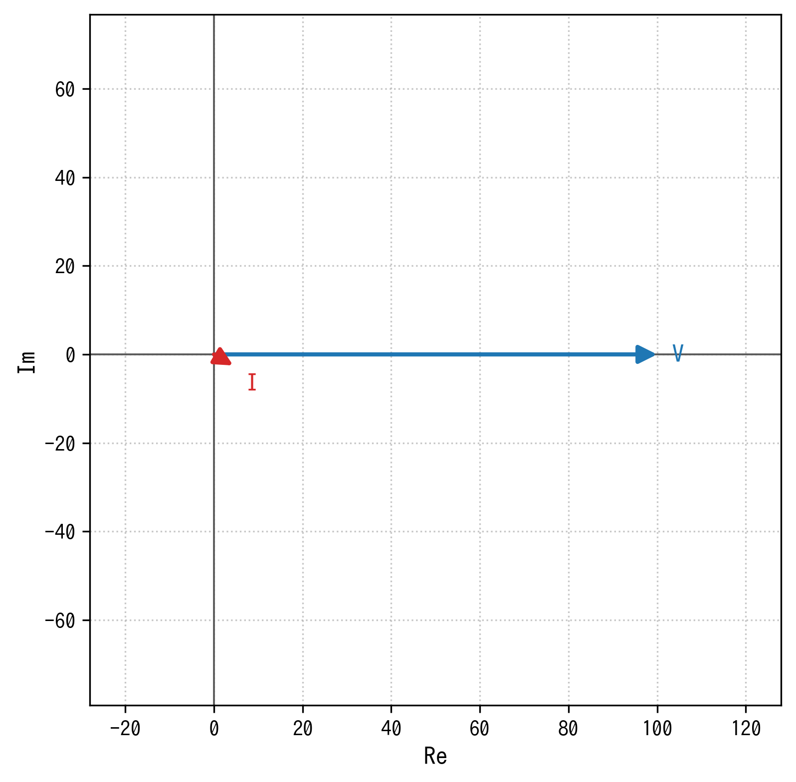
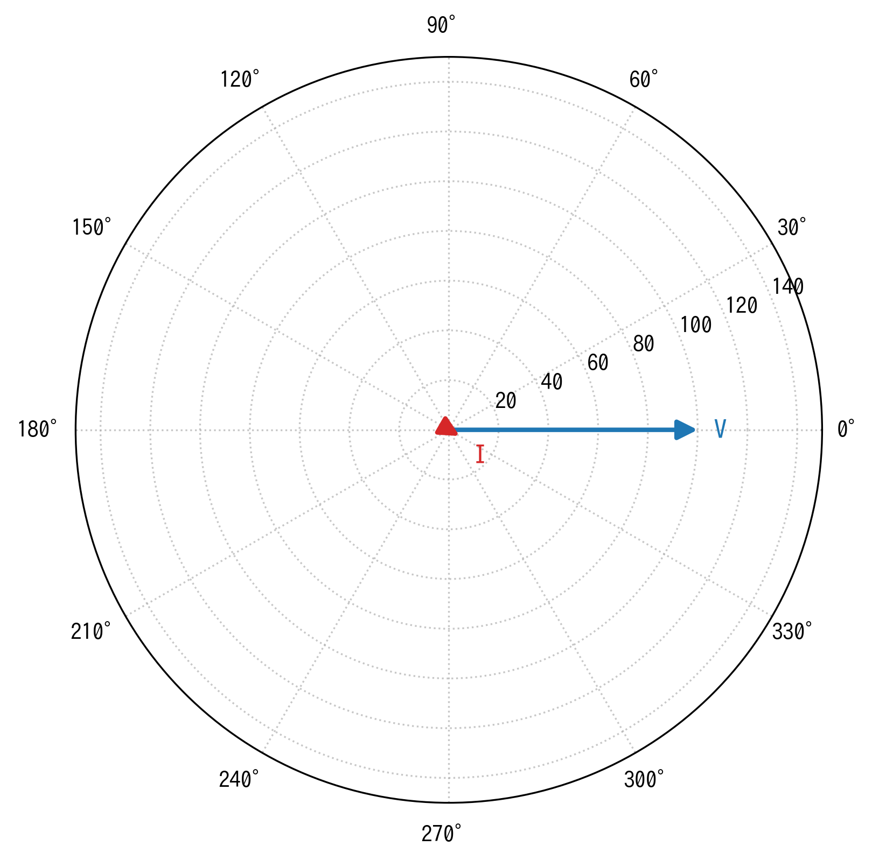
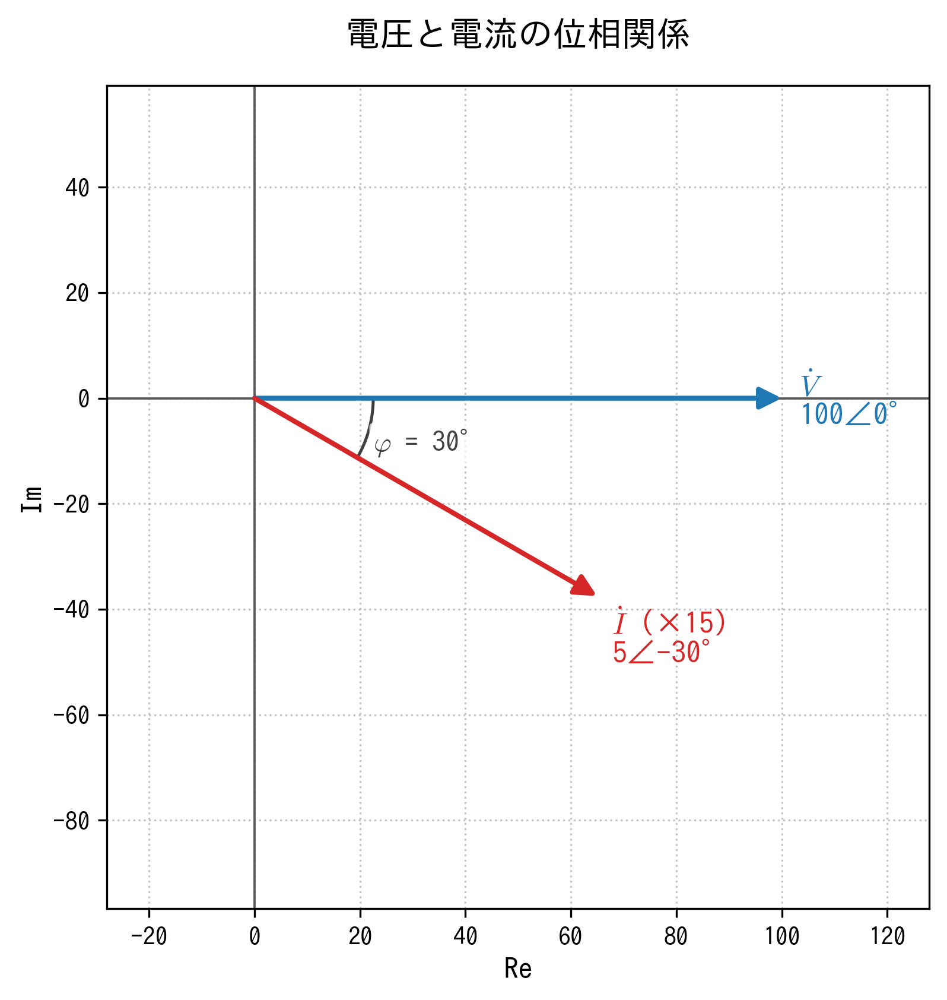
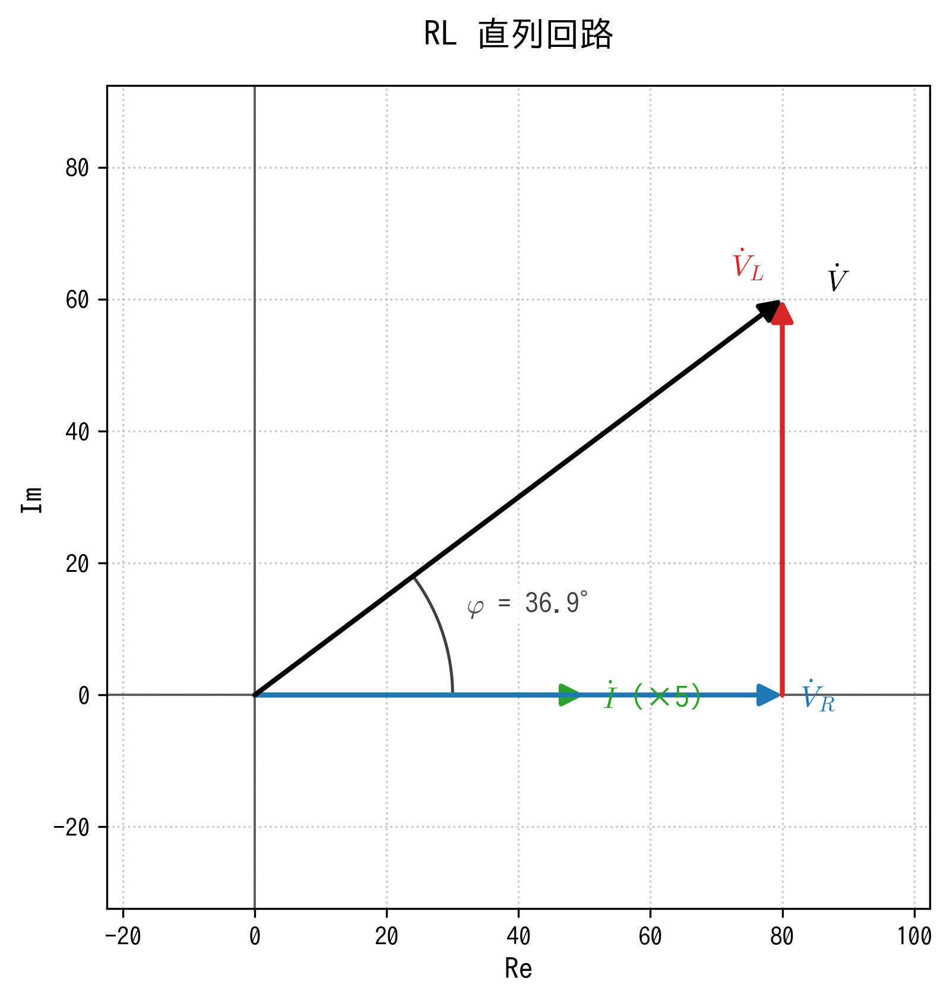
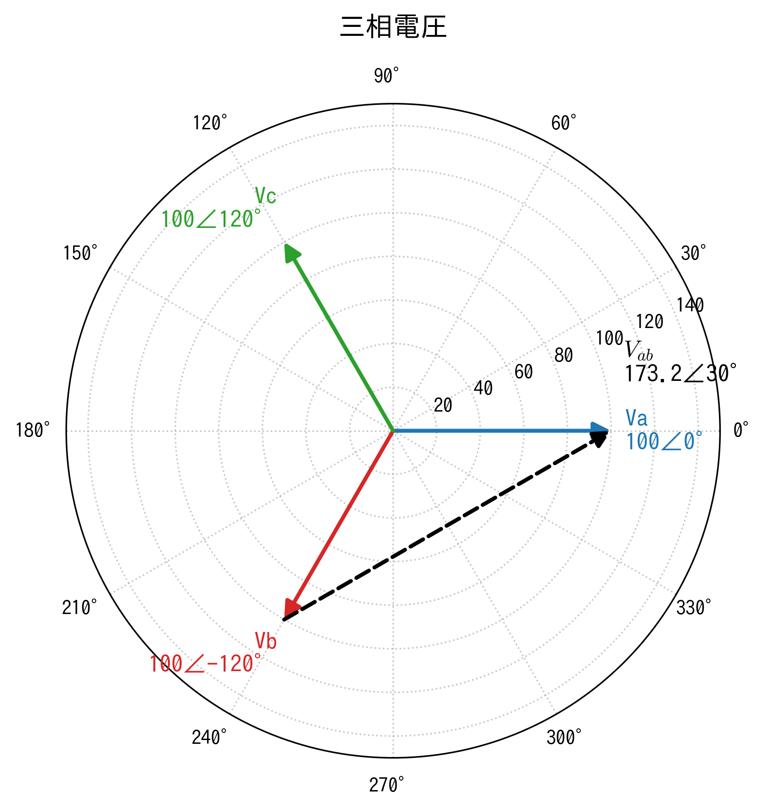

# phasorplot

レポート用の **フェーザ図 / 極座標図** を、メソッドを呼ぶだけで作れる Python ライブラリです(matplotlib ベース)。

- `mode="phasor"` ⇄ `mode="polar"` を切り替えるだけで、**フェーザ図(複素平面)** と **極座標図** を選べる
- 角度の円弧、値ラベル(`100∠30°`)、頭つなぎ(ベクトルの足し算)、合成・差、補助線、文字の追加がワンメソッド
- 日本語フォントを自動検出(タイトルやラベルに日本語を使っても文字化けしにくい)
- `.png` / `.pdf` / `.svg` で保存可能。既定 300 dpi でそのままレポートに貼れる

| フェーザ図 (`phasor`) | 極座標図 (`polar`) |
| :---: | :---: |
|  |  |

## インストール

```bash
cd phasorplot
pip install .          # 通常
pip install -e .       # 開発用(編集がすぐ反映される)
```

必要なもの: Python 3.9 以上、`matplotlib`、`numpy`

## 使い方

### 1. 1 行で描く

```python
import phasorplot as pp

pp.plot({"V": (100, 0), "I": (5, -30)}, mode="phasor", save="out.png")
pp.plot({"V": (100, 0), "I": (5, -30)}, mode="polar",  save="out_polar.png")
```

値は `(大きさ, 角度[deg])`、`(大きさ, 角度, {オプション})`、複素数 `3+4j` のどれでも指定できます。

### 2. 情報を足していく

```python
import phasorplot as pp

d = pp.PhasorDiagram(mode="phasor", title="電圧と電流の位相関係", show_values=True)
d.add("V", 100, 0, label=r"$\dot{V}$")
d.add("I", 5, -30, scale=15, label=r"$\dot{I}$")   # 電流は 15 倍して表示
d.add_angle("V", "I", label=r"$\varphi$")          # 角度を円弧と値で表示
d.save("out.png")
```



メソッドは `self` を返すので、チェーンでも書けます。

```python
pp.PhasorDiagram("polar").add("V", 100, 0).add("I", 5, -30, scale=15).save("out.png")
```

### 3. ベクトルの頭つなぎと合成(RL 直列回路)

`origin` にフェーザ名を渡すと、そのフェーザの**先端から**描きます。

```python
d = pp.PhasorDiagram("phasor", title="RL 直列回路")
d.add("I",   10, 0,  scale=5, label=r"$\dot{I}$", color="tab:green")
d.add("V_R", 80, 0,  label=r"$\dot{V}_R$")
d.add("V_L", 60, 90, origin="V_R", label=r"$\dot{V}_L$", label_offset=(-14, 0))
d.add_sum("V", ["V_R", "V_L"], label=r"$\dot{V}$", label_offset=(12, -2))
d.add_angle(None, "V", label=r"$\varphi$", radius=30)   # None = 実軸
d.save("rl_circuit.png")
```



### 4. 三相交流と線間電圧

```python
d = pp.PhasorDiagram("polar", title="三相電圧", show_values=True)
d.add("Va", 100, 0).add("Vb", 100, -120).add("Vc", 100, 120)
d.add_difference("Vab", "Va", "Vb", linestyle="--", label=r"$V_{ab}$", label_offset=(0, 20))
d.save("three_phase.png")
```



その他のサンプルは [`examples/`](examples) にあります。

## API リファレンス

### `PhasorDiagram(mode="phasor", **options)`

| 引数 | 既定値 | 説明 |
| --- | --- | --- |
| `mode` | `"phasor"` | `"phasor"`(フェーザ図) / `"polar"`(極座標図)。`"フェーザ"` `"極座標"` も可 |
| `angle_unit` | `"deg"` | 角度の入力・表示単位(`"deg"` / `"rad"`) |
| `title` | `None` | タイトル |
| `figsize` | `(6, 6)` | 画像サイズ [inch] |
| `grid` | `True` | グリッド表示 |
| `show_values` | `False` | 全ラベルに `100∠30°` を付ける |
| `legend` | `False` | 凡例を表示 |
| `limit` | 自動 | 軸範囲の固定(phasor: ±limit、polar: 0〜limit) |
| `angle_step` | `30` | polar の角度目盛の間隔 [deg] |
| `font` | 自動 | フォント名(未指定なら日本語フォントを自動検出) |
| `font_size` | `12` | ラベルの文字サイズ |
| `xlabel` / `ylabel` | `"Re"` / `"Im"` | phasor モードの軸ラベル |

### 要素の追加

| メソッド | 説明 |
| --- | --- |
| `add(name, magnitude, angle=0, **style)` | 大きさと角度でフェーザを追加 |
| `add_complex(name, z, **style)` | 複素数でフェーザを追加 |
| `add_sum(name, names, **style)` | 既存フェーザのベクトル和 |
| `add_difference(name, a, b, **style)` | 差 `a - b`(線間電圧など)。`b` の先端から `a` の先端へ描く |
| `add_angle(start, end, label=None, radius=None, signed=False, ...)` | 2 つのフェーザ間の角度(円弧+値)。`None` は実軸 |
| `add_line(start, end, **style)` | 補助線(位置にはフェーザ名も使える) |
| `add_text(position, text, **style)` | 任意位置に文字を追加 |

`add()` のスタイル引数:

| 引数 | 説明 |
| --- | --- |
| `origin` | 始点。`None`=原点、フェーザ名=その先端、`(x, y)` / 複素数 も可 |
| `scale` | 表示倍率。電圧と電流など桁が違うときに使う(ラベルに `(×15)` が付く) |
| `color` / `linestyle` / `linewidth` / `alpha` | 見た目 |
| `label` | 表示する文字列(省略時は `name`)。`r"$\dot{V}_1$"` のような数式も可 |
| `show_value` | このフェーザだけ値ラベルの有無を上書き |
| `components` | `True` で実部・虚部への射影(点線)を描く |
| `label_offset` | ラベルを `(右, 上)` へ [pt] ずらす。ラベルが重なったとき用 |

### 出力

| メソッド | 説明 |
| --- | --- |
| `save(path, dpi=300, transparent=False)` | 画像を保存(拡張子で形式が決まる。フォルダは自動作成) |
| `show()` | 画面に表示 |
| `render()` | matplotlib の `(fig, ax)` を返す(さらに細かく調整したいとき) |

## 補足

- **参照順序**: `origin="V_R"` や `add_angle("V", "I")` のように名前で参照するフェーザは、**先に `add()` しておく**必要があります。
- **日本語フォント**: Yu Gothic / Meiryo / Hiragino / IPAex / Noto Sans CJK JP などを自動検出します。見つからない場合は `font="フォント名"` を指定してください(Linux なら `sudo apt install fonts-noto-cjk` など)。
- **角度の単位**: `angle_unit="rad"` にすると入力も表示もラジアンになります。
- **電気系の記号**: ドット付きの `\dot{V}` などは matplotlib の数式記法(`r"$\dot{V}$"`)でそのまま使えます。
- **`add_angle` の符号**: 既定では絶対値(例: `φ = 30°`)を表示します。進み・遅れを区別したいときは `signed=True`。

## ディレクトリ構成

```
phasorplot/
├── pyproject.toml            # パッケージ設定
├── README.md                 # このファイル
├── LICENSE                   # MIT
├── .gitignore
├── src/
│   └── phasorplot/
│       ├── __init__.py       # 公開 API(PhasorDiagram, plot)
│       ├── diagram.py        # PhasorDiagram 本体
│       └── _utils.py         # 複素数変換・軸範囲の丸め・日本語フォント検出
├── examples/
│   ├── 01_basic.py           # 基本(phasor / polar / 角度表示)
│   ├── 02_rl_circuit.py      # RL 直列回路(頭つなぎ・合成)
│   └── 03_three_phase.py     # 三相交流(線間電圧)
├── tests/
│   └── test_diagram.py       # pytest
└── docs/
    └── images/               # README 用の画像(examples を実行すると再生成)
```

## 開発

```bash
pip install -e ".[dev]"
pytest
python examples/01_basic.py     # docs/images/ に画像を再生成
```

## ライセンス

MIT License
